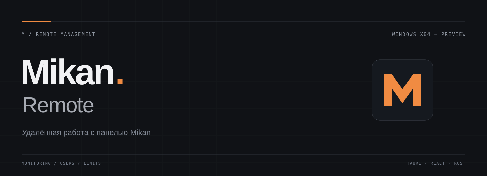

<a href="docs/GUIDE.md">Руководство</a> &nbsp; · &nbsp; <a href="docs/DEVELOPMENT.md">Разработка</a>

## Mikan Remote

Десктопное приложение для работы с [Mikan](https://github.com/Miroshka000/mikan): мониторинг сервиса, создание пользователей и изменение лимитов в отдельном Windows-окне.

Только данные подключённой панели. Переключатель демо удалён, демонстрационный экран и набор вымышленных данных больше не используются.

### 01 — Мониторинг

Показатели сервиса, график входящего и исходящего трафика, последнее состояние нод по данным панели. Ручное обновление или обновление главной каждые 30 секунд.

### 02 — Пользователи

Создание по существующему тарифу и частичное редактирование по ID: имя, контакт, заметка, лимиты трафика и устройств, включение и отключение доступа.

### 03 — Подтверждение

Перед записью приложение показывает пользователя и изменения. При потере ответа запрос автоматически не повторяется.

---

## Установка

Переименование исходников не обновляет ранее опубликованный установщик. Для версии Mikan Remote требуется новая сборка; наличие нового установщика в Releases проверяйте отдельно.

После публикации скачайте файл `Mikan Remote_…_x64-setup.exe` из Assets нужного релиза и установите его. Для самостоятельной сборки следуйте [руководству](docs/GUIDE.md).

В «Настройках» укажите полный HTTPS-адрес админки с секретным путём и собственный API-ключ. Для просмотра — права чтения, для изменений — права записи. Ключи и адрес панели не публикуйте.

## Границы текущей версии

Предварительная версия, не официальный клиент Mikan. Смена тарифа и срока, дополнительные пакеты трафика, управление тарифами и конфигурацией серверов ещё не реализованы. Серверы и платежи доступны для просмотра.

Локальные события не являются аудитом панели. Полученный список не гарантирует загрузку всех страниц API. Повторная проверка данных перед сохранением не является атомарной блокировкой. Совместимость со всеми версиями Mikan не заявляется.

---

Tauri 2 / React / TypeScript / Rust · Windows x64

Для обратной связи используйте вкладку Issues и соответствующий шаблон. Укажите версии приложения и Mikan, шаги воспроизведения и обезличенный текст ошибки.
